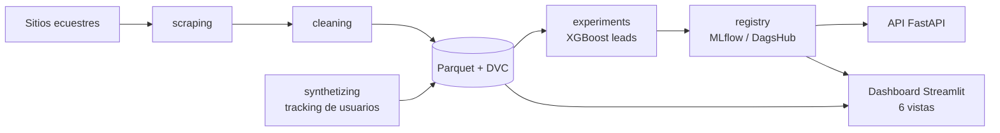

<p align="center"></p>

<h1 align="center">EquineLead</h1>

<p align="center"><b>Equestrian-market analytics: audience, inventory and business opportunities.</b></p>

<p align="center"></p>

<p align="center">
      
</p>

<p align="center"><a href="https://dodysalim.github.io/"><b>🌐 Portfolio</b></a> · <a href="https://nocountry.tech/showcase/simulacion-laboral-febrero-2026/equipo-45-data-science"><b>🏆 No Country Showcase</b></a> · <a href="README.md"><b>🇪🇸 Versión en español</b></a></p>

---

## 📌 At a glance

| | |
| --- | --- |
| **🎯 Problem** | Relate visits, engagement and inventory to conversion opportunities. |
| **🛠️ Solution** | Team ML pipelines and services, DVC-versioned data and efficient Parquet loading. |
| **📈 Deliverables** | 6-view dashboard (inventory, retail, audience, conversion, AI) and Power BI. |
| **👤 My role** | Data Analyst in a 4-person team. |

## 🏗️ Architecture



## 🚀 How to run

```bash
pip install -r app/requirements.txt
cp .env.example .env
python -m streamlit run app/app.py
```

## ⚖️ Scope

Requires the original Parquet files or DVC/GCP access; it never substitutes fake data.

## 👥 Team

Team: Alexander Rios · Daisy Quinteros · Iñaki Rosello · Dody Dueñas (Data Analyst). Collective authorship is preserved.

---

<p align="center">
<b>Dody Dueñas Remache</b> · Data Analyst / Data Scientist · Guayaquil, Ecuador (remote LATAM)<br>
<a href="https://dodysalim.github.io/">Portfolio</a> · <a href="https://github.com/dodysalim">GitHub</a> · <a href="https://www.linkedin.com/in/dody-duenas/">LinkedIn</a> · <a href="mailto:dodydurema67@gmail.com">dodydurema67@gmail.com</a>
</p>
