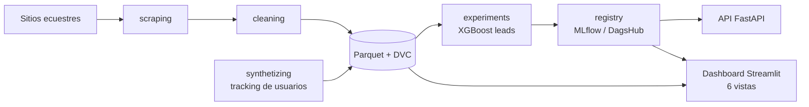

<p align="center"></p>

<h1 align="center">EquineLead</h1>

<p align="center"><b>Analítica del mercado ecuestre: audiencia, inventario y oportunidades comerciales.</b></p>

<p align="center">

</p>

<p align="center">
      
</p>

<p align="center">
<a href="https://github.com/dodysalim/S02-26-E45-Data_Science_EquineLead/actions"></a>  
</p>

<p align="center"><a href="https://nocountry.tech/showcase/simulacion-laboral-febrero-2026/equipo-45-data-science"><b>🏆 Showcase No Country</b></a> · <a href="https://dodysalim.github.io/"><b>🌐 Portafolio</b></a> · <a href="docs/PORTFOLIO_CASE.md"><b>📄 Caso de estudio</b></a> · <a href="README.en.md"><b>🇺🇸 English</b></a></p>

---

## 📌 Resumen en 30 segundos

| | |
| --- | --- |
| **🎯 Problema** | Relacionar visitas, interacción e inventario con oportunidades de conversión. |
| **🛠️ Solución** | Pipelines y servicios de ML del equipo, datos versionados con DVC y carga eficiente de Parquet. |
| **📈 Entregables** | Dashboard de 6 vistas (inventario, retail, audiencia, conversión e IA) y Power BI. |
| **🧪 Calidad** | Pruebas de rutas y lectura de datos; arranque seguro sin credenciales. |
| **👤 Mi rol** | Data Analyst en equipo de 4 personas. |

## ❓ La pregunta de negocio

¿Cómo se relacionan visitas, interacción e inventario con las oportunidades de conversión?

## ✨ Qué incluye

- Seis vistas de inventario, retail, audiencia, conversión y subsistema de IA.
- Carga de Parquet con selección de columnas y límites para sesiones.
- Pipeline y servicios de ML del equipo; versionado de datos con DVC.

## 🏗️ Arquitectura



## 🚀 Cómo ejecutarlo

Usa Python 3.11 o 3.12 en un entorno independiente. Desde la raíz:

```bash
python -m venv .venv
# Windows: .venv\Scripts\activate
# macOS/Linux: source .venv/bin/activate
python -m pip install -r app/requirements.txt
```

Después de configurar los datos:

```bash
python -m streamlit run app/app.py
```

## 🗂️ Datos y configuración

Para los servicios del equipo, copia `.env.example` como `.env` y completa tus credenciales (el archivo `.env` no se sube a Git).

Necesita los cinco Parquet originales en data/clean o app/data/clean, o acceso DVC/GCP (EQUINE_DATA_DIR permite otra ruta). Sin ellos muestra instrucciones; no sustituye los datos por un conjunto ficticio.

## 📊 Power BI · PC y móvil

[Archivos e instrucciones](powerbi/README.md). Descarga el repositorio completo y abre `powerbi/Abrir-PowerBI.bat` en Windows; después pulsa **Actualizar**. Incluye A4 horizontal a tamaño real (100 %) y diseño móvil vertical. El archivo `.pbip` necesita sus carpetas Report, SemanticModel y data.

## 🧭 Estructura del repositorio

| Ruta | Qué contiene |
| --- | --- |
| [app/](app/) | Dashboard y módulos analíticos |
| [src/](src/) | Pipelines, modelos y API |
| [docs/](docs/) | Arquitectura y metodología |
| [assets/](assets/) | Identidad visual del equipo |

## ✅ Calidad y alcance

Arranque sin credenciales comprobado: presenta las instrucciones de configuración, sin excepción. Tres pruebas de rutas y lectura Parquet aprobadas: reconoce la salida DVC, prioriza una carpeta completa y respeta una ruta explícita.

No se reentrenaron los modelos ni se validó la API remota, GCP, DagsHub o la descarga DVC. Las sesiones se limitan a 10.000 filas por tabla en la vista inicial.

## 👥 Autoría

No Country S02-26-E45. Rol documentado de Dody Dueñas: Data Analyst; arquitectura y modelos son trabajo colectivo.

| Nombre | Rol |
| --- | --- |
| **Alexander Rios** | Data Scientist & ML Engineer |
| **Daisy Quinteros** | Data Engineer & Data Scientist |
| **Iñaki Rosello** | Data Scientist & ML Engineer |
| **Dody Dueñas** | Data Analyst |


[Documentación anterior](docs/ORIGINAL_README.md), conservada como referencia histórica.

## Despliegue del equipo

La cadena Docker/GCP del equipo se activa con la variable de repositorio `DEPLOY_ENABLED=true` y sus credenciales. Sin esa configuración, el fork no intenta desplegar en servicios del equipo.

---

<p align="center">
<b>Dody Dueñas Remache</b> · Analista de Datos / Data Scientist<br>
<a href="https://dodysalim.github.io/">Portafolio</a> · <a href="https://github.com/dodysalim">GitHub</a> · <a href="https://www.linkedin.com/in/dody-duenas/">LinkedIn</a> · <a href="mailto:dodydurema67@gmail.com">dodydurema67@gmail.com</a>
</p>
